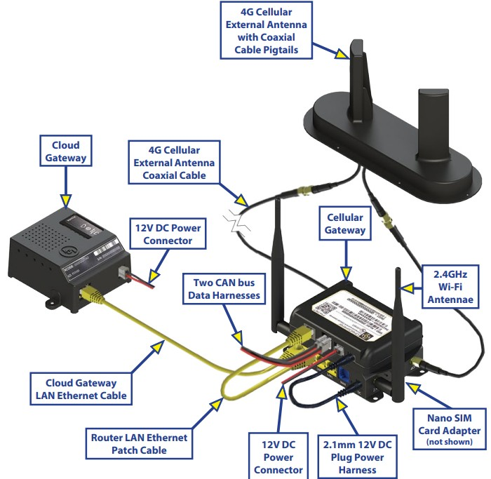

# GW

The way these devices work:
- Cloud Gateway get the IP of `192.168.1.2` (which is the PI unit and also includes openhab2 processes)
	- dns relay
- Celluar Gateway is two parts the bottom unit is a router (which was DD-WRT but is not a custom router) with the IP of `192.168.1.1`
- the unit above is the interface to the CANBUS and runs off the IP of `??????`




## Unlock access to GW

Remove the SD card from the Gateway and mount it in a linux or Pi computer.    With MicroSD mounted in Linux and access 2nd partition which will show as a mount type ext4.

In the root of the mount point base directory
- Added empty zero byte file `ssh` : this will result in the PI enabling the SSHD so that you can connect to it.  This is documented in [Rasp PI](https://www.raspberrypi.com/documentation/computers/configuration.html#remote-access) under Remote access.  

Now let's create a user id to use in that SSD session. 

(note for below `dj` is my user account and `mypassword` is the password)

- Add to `/etc/passwd`
		`dj:x:1001:1000:,,,:/home/pi:/bin/bash`
	
- Add to `/etc/shadow` (exc) using 
			`openssl passwd -6 -salt xyzsalt  mypassword`

We need to build a string to put into shadow ([see Docs](https://linuxize.com/post/etc-shadow-file/)).  We start with the user id `dj` and seperator `:` add the salted string from above `$6$xyzsalt$JJzQkBsqgkiVtmiZ1z9Utu2z/jMXp9t1VFzWgNOhekoJ4.UUoTA0u4bBpuqx5XUdKZYnaP8XtlWXz0wfUTYsc` then we add a filler components of `:19504:0:99999:7:::` which represents last password change, min/max password age, warning, inactive, expiration values.  Combined together you get the line to add to `etc/shadow`
```
dj:$6$xyzsalt$JJzQkBsqgkiVtmiZ1z9Utu2z/jMXp9t1VFzWgNOhekoJ4.UUoTA0u4bBpuqx5XUdKZYnaP8XtlWXz0wfUTYsc:19504:0:99999:7:::
```
- In `/etc/sudoers.d`
		`sudo nano 010_pi-nopasswd`
Edit file and added word to `dj` beside `pi`  ([Docs on sudoers](https://www.man7.org/linux/man-pages/man5/sudoers.5.html))

- ssh onto pi using `dj` and `mypassword`	

### Optional if ssh is not letting you access ssh
Change /etc/network/
~~~bash
mv interfaces interfaces.save
cat > interfaces
    # interfaces(5) file used by ifup(8) and ifdown(8)
	  # Include files from /etc/network/interfaces.d:
source /etc/network/interfaces.d/*
~~~

If GW is going up and down to avoid the reboot, edit `/etc/rc.local` to reduce the cycle of reboots when mount does not work correctly.
		Change sleep `120` to `1200`


/etc/myrvcg/myrvcg.conf
~~~
	"LogToConsole":"false" (default)
	"LogLevel":"Fatal" (default)
	"AutoUpdate": "false"
	"Environment":   can be "Production", "Stage", "Test", "Development"
	"OpenHabLogLevel": "ERROR" (default)
	"CanGatewayAddress":"192.168.1.1"
~~~

## commands in GW
- `/sbin/cryptsetup luksOpen --test-passphrase -T1 /home/pi/data` when prompted the default password used it below, later the password is changed to a combination of the Serial and MAC
- `/sbin/cryptsetup-reencrypt /home/pi/data --cipher aes-cbc-essiv:sha256 --key-size 256`
- `/sbin/cryptsetup luksChangeKey /home/pi/data`
- `/sbin/cryptsetup luksOpen /home/pi/data cfile`
- `/sbin/e2fsck -p -f /dev/mapper/cfile`
- `/bin/mount -t auto /dev/mapper/cfile /mnt/cfile`
- `/usr/sbin/update-rc.d ssh enable`

### other elements
- `/proc/cpuinfo`	used to get serial # for key
- `Manufacturing`   This is the orginal default password to unlock luksOpen
- `Serial`            The Serial number is used as part of the encryption key along with the MAC address read from cpuinfo
- The mac address format as part of the encryption key `%02X%02X%02X%02X%02X%02X`


Using a 64 hex digit hash key = 16^64 combos

## Alternate approach
Alternative approach is to create a userconf.txt in the root of of the volume to automatically create an login account.

